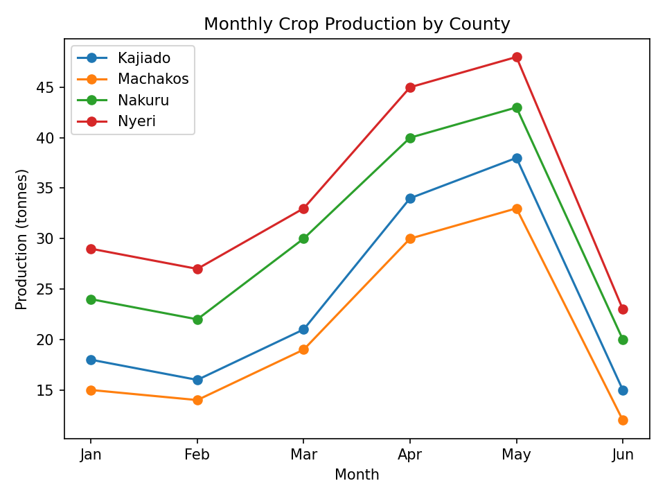

# Agriculture & Food Security Analysis (pandas)

A pandas and matplotlib project exploring rainfall, crop production, yield and a simple food-security index across four Kenyan counties (Kajiado, Machakos, Nakuru and Nyeri) from January to June.

> **Note:** all figures in the dataset are fictional and used for practice.

## Questions answered

1. How many rows and columns are there, and are there missing values or duplicates?
2. What are the average rainfall and crop production per county?
3. Which county has the highest total crop production?
4. Which month has the highest average rainfall across counties?
5. What is the percentage change in production from January to June per county?
6. How strongly are rainfall and crop production correlated?
7. How does monthly crop production compare across counties? (line chart)

## Key findings

| Question | Result |
|---|---|
| Data quality | 24 rows, 6 columns, no missing values, no duplicates |
| Highest total production | Nyeri (205 tonnes), then Nakuru (179), Kajiado (142), Machakos (123) |
| Wettest month | May (117.5 mm average) |
| Production change, Jan to Jun | Down 17% to 21% in every county (Nyeri -20.7%, Machakos -20.0%, Kajiado and Nakuru -16.7%) |
| Rainfall vs production | Correlation of 0.97 (very strong positive) |

Production rises with the April-May rains in every county and drops in June as rainfall falls. A high correlation does not prove causation, and with only 24 fictional data points it should be read as illustrative.



## Project structure

```
agriculture-food-security-analysis/
├── agriculture.py
├── data/
│   └── 06_agriculture_food_security.csv
├── outputs/
│   ├── agriculture_food_security.png
│   └── agriculture_food_security.pdf
├── requirements.txt
└── README.md
```

## How to run

```bash
git clone https://github.com/Patrick001-DA/agriculture-food-security-analysis.git
cd agriculture-food-security-analysis
pip install -r requirements.txt
python agriculture.py
```

## Skills demonstrated

Data inspection and cleaning, `groupby` aggregation, `pivot`, percentage change, correlation, and data visualisation with matplotlib.

## Possible next steps

- Analyse `yield_tonnes_per_hectare` and `food_security_index` against rainfall
- Build a county-level food-security comparison chart

## Author

Patrick Njuguna Muchemi
